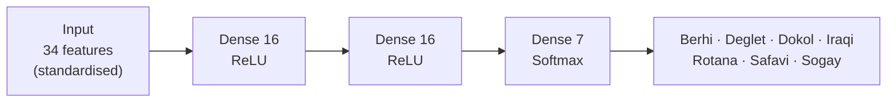

<div align="center">

# 🌴 Rutab

### Date Fruit Variety Classifier

**A neural network that identifies 7 varieties of date fruit from 34 image-derived measurements, with an interactive dashboard to explore how it thinks.**

[](https://gentle-madeleine-5a3425.netlify.app)


<!-- Add a screenshot or GIF of the app here: -->
<!--  -->

</div>

---

## ✨ Overview

Rutab (Arabic for ripe dates) is an end-to-end machine learning project: a compact **multilayer perceptron** trained to tell apart seven date varieties, wrapped in a **zero-dependency web dashboard** that lets you play with the model instead of just reading a metrics table.

Drag a slider, watch the prediction change, and see activations flow through the network layer by layer.

| | |
|---|---|
| **Task** | Multi-class classification (7 varieties) |
| **Input** | 34 morphological, shape and colour features per fruit |
| **Model** | MLP, `34 → 16 → 16 → 7` (951 trainable parameters) |
| **Test accuracy** | **93.3%** on 180 held-out fruits |
| **Frontend** | Single-file HTML, CSS and vanilla JS. No build step, no framework |

---

## 🖥️ The dashboard

| Tab | What it does |
|---|---|
| **Classify** | Adjust 8 key measurements (area, perimeter, major and minor axis, eccentricity, solidity, extent, aspect ratio) or load a sample from any variety. Get the predicted variety, a confidence score and the top-3 probabilities, plus an animated **inference trace** of activations from input to softmax. Save results to a running history. |
| **Batch** | Drop in a CSV with the dataset's column names and classify every row in the browser. Results are summarised per variety. Nothing is uploaded. |
| **Model** | Explore the training run: accuracy and loss curves with an epoch scrubber, class distribution, and the full architecture table. |

**Design notes:** responsive layout (sidebar on desktop, bottom nav on mobile), automatic light and dark theme, keyboard-accessible controls with visible focus states, and `prefers-reduced-motion` support.

---

## 🧠 Model



| Layer | Activation | Parameters |
|---|---|---:|
| Input (34) | none | 0 |
| Dense (16) | ReLU | 560 |
| Dense (16) | ReLU | 272 |
| Dense (7) | Softmax | 119 |
| **Total** | | **951** |

**Training setup:** Adam optimiser, categorical cross-entropy loss, batch size 8, 100 epochs, standardised inputs.

---

## 📊 Results

| Split | Accuracy |
|---|---:|
| Training (epoch 100) | 98.9% |
| Validation (epoch 100) | 91.0% |
| **Test (180 fruits)** | **93.3%** |

### What the training curves show

- Validation loss is lowest at **epoch 42** (0.215) and then climbs to 0.306 by epoch 100, while training loss keeps falling. This is a clear **overfitting** signature.
- Validation accuracy plateaus around 91 to 92% from roughly epoch 30 onwards, so the extra epochs buy nothing on unseen data.
- **Early stopping** (monitoring `val_loss`) or light regularisation (dropout or L2) would be the natural next step. See the [roadmap](#-roadmap).

### Dataset

898 date fruits across 7 varieties, each described by 34 features extracted from images.

| Variety | Fruits | | Variety | Fruits |
|---|---:|---|---|---:|
| Dokol | 204 | | Berhi | 65 |
| Safavi | 199 | | Iraqi | 72 |
| Rotana | 166 | | Sogay | 94 |
| Deglet | 98 | | | |

The classes are **imbalanced** (Dokol has about 3× as many samples as Berhi), which is worth keeping in mind when reading overall accuracy.

---

## 🚀 Run it locally

No install, no build.

```bash
git clone https://github.com/YOUR-USERNAME/rutab-date-classifier.git
cd rutab-date-classifier
open index.html        # macOS
# start index.html     # Windows
# xdg-open index.html  # Linux
```

Or serve it:

```bash
python -m http.server 8000
# then visit http://localhost:8000
```

### Batch CSV format

Your file needs these column headers (case-insensitive):

```csv
AREA,PERIMETER,MAJOR_AXIS,MINOR_AXIS,ECCENTRICITY,SOLIDITY,EXTENT,ASPECT_RATIO
375000,2250,900,530,0.65,0.98,0.72,1.70
```

---

## 🌐 Deploy

This is a static site, so it works on any host.

**GitHub Pages:** Settings → Pages → Source: `main` branch, `/ (root)` → Save.
**Netlify / Vercel / Cloudflare Pages:** drag in the folder, or connect the repo. No build command is needed.

---

<details>
<summary><b>⚠️ About the demo's inference (please read)</b></summary>

<br>

The dashboard currently runs in **sandbox mode**, as the badge in the header says. Predictions in the browser come from a lightweight scoring function that approximates class prototypes, and the 26 features not exposed as sliders are derived synthetically. The **metrics, training curves, architecture and dataset statistics shown are from the real trained model.**

To run the actual network in the browser, export the Keras model to TensorFlow.js and replace the `probs()` function in `index.html` (marked with a comment) so it returns the 7 class probabilities in this order:

`BERHI, DEGLET, DOKOL, IRAQI, ROTANA, SAFAVI, SOGAY`

You will also need the training-set mean and standard deviation for each of the 34 features so inputs can be standardised exactly as they were during training.

</details>

---

## 🗺️ Roadmap

- [ ] Run the trained model in-browser with **TensorFlow.js** (replace sandbox scoring)
- [ ] Add **early stopping** and **dropout**, then compare validation curves
- [ ] Handle class imbalance (class weights or stratified sampling) and report **per-class precision, recall and F1**
- [ ] Add a **confusion matrix** view to the Model tab
- [ ] Image upload: extract features from a photo of a date and classify it end to end
- [ ] k-fold cross-validation for a more reliable accuracy estimate on a small dataset

---

## 📁 Project structure

```
.
├── index.html     # The full dashboard: markup, styles and logic in one file
└── README.md
```

*(Add your training notebook, for example `notebooks/train.ipynb`, here to make the project reproducible end to end.)*

---

## 🙏 Acknowledgements

- Dataset: the **Date Fruit Datasets** (898 fruits, 7 varieties, 34 features) from Koklu, Kursun, Taspinar and Cinar, *"Classification of Date Fruits into Genetic Varieties Using Image Analysis"*, Mathematical Problems in Engineering, 2021. Please verify the citation against the source you downloaded the data from.
- Fonts: [Bricolage Grotesque](https://fonts.google.com/specimen/Bricolage+Grotesque) and [IBM Plex Mono](https://fonts.google.com/specimen/IBM+Plex+Mono) via Google Fonts.

---

## 👤 Author

**Tejas Kulkarni**
[LinkedIn](https://linkedin.com/in/YOUR-PROFILE) · [GitHub](https://github.com/YOUR-USERNAME) · [Email](mailto:you@example.com)

<div align="center">

If you found this useful, consider giving it a ⭐

</div>
